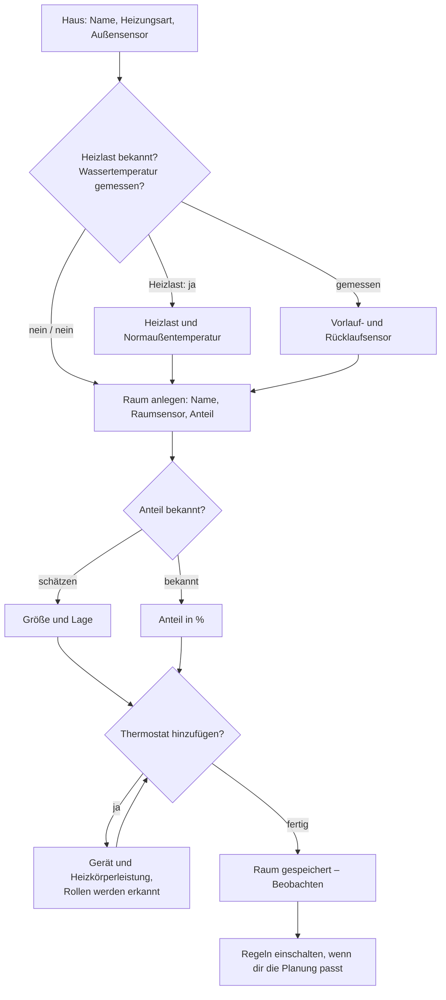

# Erste Schritte

[English](../en/getting-started.md) | **Deutsch**

> Thermogeist steht noch am Anfang. Du kannst dein Haus und seine [Räume](rooms.md) beschreiben.
> Thermostate zuordnen und Räume regeln geht schon – siehe [Thermostate](thermostats.md).

## Installieren

**Von Hand aus dem Zip**

1. Lade `thermogeist.zip` aus dem neuesten Release herunter.
2. Entpacke es nach `config/custom_components/thermogeist/` in deinem Home Assistant.
3. Starte Home Assistant neu.

Die Installation über HACS beschreiben wir, sobald Thermogeist veröffentlicht ist.

## Dein Haus beschreiben

Öffne **Einstellungen → Geräte & Dienste → Integration hinzufügen** und suche nach
**Thermogeist**.

Die ganze Einrichtung auf einen Blick – jeder Kasten ist ein Schritt im Dialog:

### Schritt 1: die drei wichtigsten Angaben

| Feld | Was du einträgst |
|---|---|
| Name | So soll das Haus heißen, z. B. „Haus“ oder „Einliegerwohnung“. |
| Heizungsart | Wärmepumpe, Kessel (Gas, Öl, Pellets, Fernwärme) oder Elektro-Direktheizung. Davon hängt ab, wie ruhig Thermogeist regelt. |
| Außentemperatursensor | Ein beliebiger Sensor für die Außentemperatur, z. B. eine Wetterstation oder der Außenfühler deiner Wärmepumpe. |

### Schritt 2: ein paar Fragen

Deine Antworten bestimmen, was Thermogeist als Nächstes fragt – du siehst nur Felder, die du
ausfüllen kannst.

| Frage | Was folgt |
|---|---|
| Kennst du die Heizlast? | **Ja**, wenn es eine Heizlastberechnung gibt (Heizungsbauer oder Energieberater): Ein Schritt fragt Heizlast, Normaußentemperatur und, falls bekannt, den Anteil außerhalb von Thermogeist. **Nein**: nichts weiter. |
| Wird die Wassertemperatur gemessen? | **Nein**, **nur Vorlauf** oder **Vorlauf und Rücklauf**: Ein Schritt fragt nach dem einen oder den beiden Sensoren – sorgfältig wählen, siehe [Den Vorlauf-Sensor wählen](thermostats.md#den-vorlauf-sensor-wählen). |
| Beheizte Wohnfläche | Die gesamte beheizte Fläche, ohne Balkon und Terrasse. Damit schätzt Thermogeist den Anteil jedes Raums an der Heizlast: Ein Raum mit 20 m² in einem Haus mit 160 m² startet bei etwa 12,5 %. Empfohlen. |

Die Werte in den folgenden Schritten:

| Feld | Was du einträgst |
|---|---|
| Heizlast | Die Wärme, die dein Haus am kältesten Auslegungstag braucht, in kW, aus der Heizlastberechnung. |
| Normaußentemperatur | Die Außentemperatur, für die die Heizlast berechnet wurde. |
| Anteil außerhalb von Thermogeist | Teil der Heizlast in Räumen, die Thermogeist nicht regeln soll, z. B. ein Bad mit Fußbodenheizung. Nur, wenn du ihn kennst; sonst ergibt er sich aus der Wohnfläche. |
| Vorlauf-/Rücklauftemperatursensor | Das Wasser zu den Heizkörpern und zurück; mit beiden nutzt Thermogeist die gemessene Spreizung statt 5 K anzunehmen. |

In den Haus-Einstellungen sind die Antworten vorausgewählt; wer später *Nein* antwortet,
entfernt die zugehörigen Werte.

> **Tipp: die Normaußentemperatur finden.** Sie hängt von deinem Wohnort ab. Suche im Web nach
> „Normaußentemperatur“ und deiner Postleitzahl. Hast du eine Heizlastberechnung, steht der
> Wert dort drin.

Du kannst mehrere Häuser anlegen, zum Beispiel eine Einliegerwohnung mit eigener Heizung.

## Was du danach siehst

Thermogeist legt ein Gerät für dein Haus an:

- **Zentralmodus** – *Automatisch*, *Aus* oder *Frostschutz* für das ganze Haus. Die Einstellung
  bleibt auch nach einem Neustart erhalten.
- **Regelwerte** – vier Werte, die du direkt auf der Geräteseite ändern kannst. Sie starten
  mit den Voreinstellungen deiner Heizungsart; das Attribut `source` zeigt `profile` oder `user`.
  **Regelwerte auf Profil zurücksetzen** holt die Voreinstellungen zurück. Wechselst du später
  die Heizungsart, bleiben deine eigenen Werte, die unveränderten folgen dem neuen Profil.
- **Diagnosewerte** – Heizungsart, Heizlast, Normaußentemperatur, Anteil außerhalb von
  Thermogeist und Heizlast ohne Raum.

Voreinstellungen je Heizungsart:

| Voreinstellung | Wärmepumpe | Kessel | Elektro-Direkt |
|---|---|---|---|
| Mindestöffnung Ventil | 40 % | 0 % | 0 % |
| Totband über dem Sollwert | 0,5 K | 0,2 K | 0,2 K |
| Max. Ventiländerung pro 30 min | 10 % | 30 % | 100 % |
| Max. Absenkung | 2 K | 4 K | 4 K |
| Fenster: schließen nach | 30 s | 30 s | 30 s |
| Fenster: wieder heizen nach | 10 s | 10 s | 10 s |

Warum so unterschiedlich? Eine Wärmepumpe arbeitet am besten, wenn das Wasser in Bewegung
bleibt. Deshalb hält Thermogeist die Ventile offen und bewegt sie langsam. Ein Kessel reagiert
schneller und kommt mit schließenden Ventilen gut zurecht.

## Einstellungen ändern

Öffne den Thermogeist-Eintrag und wähle **Konfigurieren**. Du kannst alles außer dem Namen
ändern, Thermogeist lädt danach neu.

Weiter: [Räume anlegen](rooms.md).
