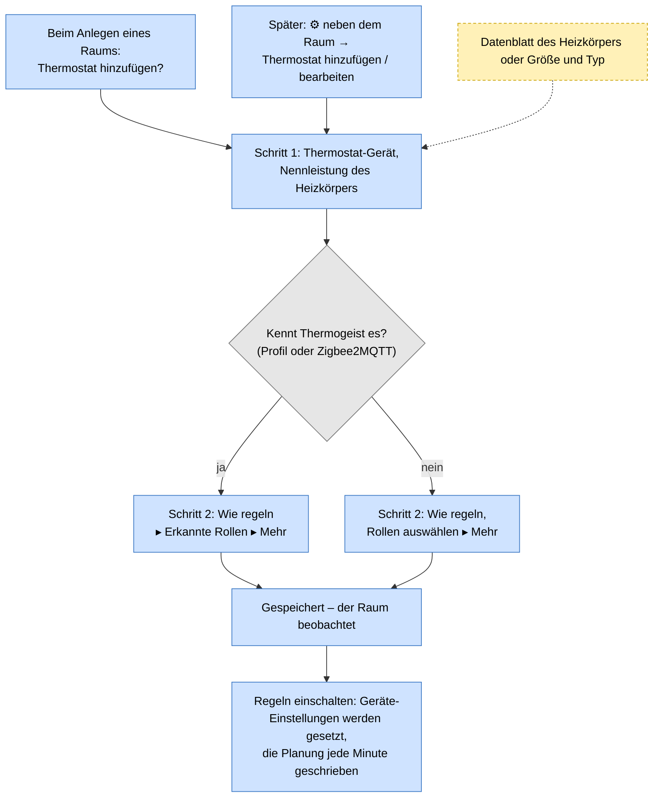
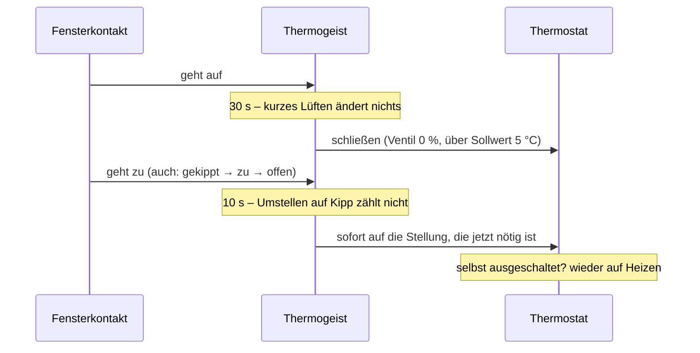
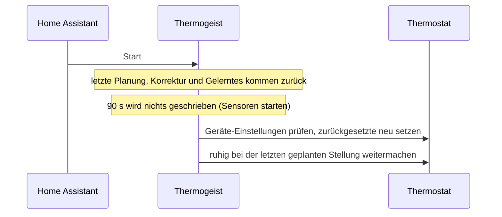

# Thermostate

[English](../en/thermostats.md) | **Deutsch**

> **Erst beobachten, dann regeln.** Neue Räume starten im Beobachtungsmodus: Thermogeist zeigt
> nur, was es tun würde. Passt dir der Plan, schalte für den Raum **Regeln** ein.

## Thermostat hinzufügen

Thermostate gehören zu ihrem Raum. Wenn du **einen Raum anlegst**, fragt Thermogeist am Ende:
**Thermostat hinzufügen** oder **Fertig** – füge dort gleich alle Thermostate des Raums hinzu.
Später: Öffne den Thermogeist-Eintrag deines Hauses, klick auf das Zahnrad (⚙) neben dem Raum
und wähle **Thermostat hinzufügen**. Ein Raum kann mehrere Thermostate haben.

Dasselbe Menü bietet **Raum bearbeiten**, **Thermostat bearbeiten** und **Thermostat entfernen**.
Um ein Thermostat in einen anderen Raum zu verschieben, entferne es hier und füge es dort hinzu;
beim Entfernen bekommt es seine eigenen Geräteeinstellungen zurück.

### Schritt 1: Gerät

| Feld | Was du einträgst |
|---|---|
| Thermostat | Das Thermostat-Gerät in Home Assistant (es braucht eine Klima-Entität). |
| Heizkörper-Nennleistung | Optional. Die Leistung des Heizkörpers in W bei 75/65/20 °C laut Datenblatt oder Typenschild. |

### Schritt 2: Was macht was?

Bekannte Modelle erkennt Thermogeist und trägt vor, welche Entität was macht. Dann ist nur **Wie
regeln** offen; die erkannten Entitäten stehen im zugeklappten Bereich *Erkannte Rollen – bei
Bedarf prüfen*, Kalibrierung und Ventil-Bestätigung unter *Mehr*. Bei einem Thermostat, das
Thermogeist nicht kennt, sind die Rollen offen. Ändere, was nicht passt; leere Felder werden
einfach nicht genutzt. Du kannst auch Entitäten
anderer Geräte wählen – manche Integrationen (z. B. Bosch Smart Home) legen Klima und
Ventilposition auf getrennte Geräte.

Um ein Thermostat später zu ändern: Zahnrad (⚙) neben seinem Raum → **Thermostat bearbeiten**.

| Rolle | Bedeutung |
|---|---|
| Klima-Entität | Pflicht. Die Klima-Entität des Thermostats. |
| Ventilstellung (lesen) | Nur, wenn das Thermostat meldet, wie weit sein Ventil wirklich offen ist. Bei den Sonoff-Thermostaten leer lassen – Thermogeist ermittelt die Stellung selbst (siehe unten). Nie die Entität aus *Ventilstellung (setzen)* wählen: Sie zeigt nur, was Thermogeist geschrieben hat (der Dialog lehnt sie ab; das Bosch BTH-RA ist die Ausnahme, die das Profil selbst einträgt). |
| Ventilstellung (setzen) | Damit kann Thermogeist das Ventil direkt stellen. Ohne sie wird über den Sollwert geregelt. |
| Mindestöffnung im Gerät | Eine im Thermostat gespeicherte Rückfallebene; sie wirkt auch, wenn Home Assistant ausfällt. |
| Eingang externe Temperatur | Damit nutzt das Thermostat deinen Raumsensor statt seines eigenen. |

Bekannte Modelle bisher:

| Modell | Art | Hinweise |
|---|---|---|
| Sonoff TRVZB | Über Ventilstellung | Firmware 1.1.4 oder neuer. Thermogeist schaltet *Smart temperature control* aus, nutzt deinen Raumsensor und stellt *Temperature accuracy* auf −0,2 K, damit das Thermostat öffnet, sobald der Raum etwas unter dem Sollwert liegt (ab Werk: 1 K). |
| Sonoff TRV-ZBT (Gen2) | Über Ventilstellung | *Smart temperature control* ausschalten. |
| Bosch Heizkörperthermostat II (BTH-RA) | Über Ventilstellung | Keine Mindestöffnung im Gerät. Hält eine geschriebene Ventilstellung nur 15 Minuten; Thermogeist bestätigt sie alle 10 Minuten. |

**Andere Thermostate über Zigbee2MQTT:** Ist die MQTT-Integration von Home Assistant
eingerichtet, liest Thermogeist, was Zigbee2MQTT über das Gerät weiß, und füllt die Rollen über
die üblichen Namen vor (Ventilstellung, Mindestöffnung, externe Temperatur, Kindersicherung). Der
Dialog zeigt dann *Aus Zigbee2MQTT erkannt (nicht getestet)*. Prüf die Vorschläge; an solchen
Thermostaten ändert Thermogeist keine Geräteeinstellungen, weil es nicht weiß, was es damit
abschalten würde. Ohne MQTT, oder wenn nichts passt, wird das Thermostat über den Sollwert
geregelt.

Alle anderen Thermostate funktionieren **über den Sollwert**: Thermogeist sagt ihnen, welche
Temperatur sie anpeilen sollen, und das Thermostat bewegt sein Ventil selbst.

### Wie regeln

Im zweiten Schritt wählst du **Wie regeln**:

| Auswahl | Was passiert |
|---|---|
| Automatisch (Standard) | Über die Ventilstellung, wenn *Ventilstellung (setzen)* ausgefüllt ist, sonst über den Sollwert. |
| Über Ventilstellung | Thermogeist stellt das Ventil selbst: ruhig, mit Mindestöffnung und Vorsteuerung. Braucht *Ventilstellung (setzen)*. |
| Über Sollwert | Das Thermostat regelt mit seinem eigenen Regler; Thermogeist schickt nur das richtige Ziel. Geht mit jedem Thermostat, auch mit ventilgesteuerten, wenn du das lieber willst. |

**Über Sollwert, mit Eingang für externe Temperatur** (z. B. Bosch): Thermogeist schickt die
Raumtemperatur ans Thermostat und setzt das Raumziel als Sollwert. Das Thermostat regelt dann
auf die echte Raumtemperatur.

**Über Sollwert, ohne externen Eingang:** Das Thermostat misst direkt am warmen Heizkörper und
würde zu früh aufhören zu heizen. Thermogeist vergleicht seinen Messwert mit dem Raumsensor
(Mittel über 30 Minuten) und rechnet den Unterschied drauf: Raumziel 20 °C, Thermostat 2,5 K
wärmer als der Raum → Sollwert 22,5 °C. Die Anzeige am Thermostat zeigt deshalb den korrigierten
Wert. Sollwerte bleiben zwischen 5 und 30 °C, in 0,5-K-Schritten.

Grenzen von *über Sollwert*: keine Mindestöffnung und keine ruhige Ventilbewegung – wie weit das
Ventil öffnet, entscheidet der Regler im Thermostat.

> **Grenze beim Regeln über den Sollwert: Alles, was am Display des Thermostats steht, wird
> ignoriert.** Am Rad drehen oder Tasten am Thermostat drücken wirkt nicht dauerhaft –
> Thermogeist stellt innerhalb von etwa einer Minute seinen eigenen Wert wieder ein. Stell die
> Temperatur in Home Assistant ein (Klima-Entität des Raums, Dashboards, Sprachassistenten).
> Der Grund: Thermogeist sieht nur den Sollwert am Thermostat, nicht, wer ihn geändert hat.
> Jemand am Rad, der eigene Zeitplan des Thermostats, seine Fensterfunktion oder sein
> Frostschutz sehen gleich aus.
>
> Weitere Grenzen: Ohne Eingang für externe Temperatur zeigt die Anzeige einen korrigierten Wert
> statt deines Raum-Sollwerts, und wie weit das Ventil öffnet, entscheidet der Regler im
> Thermostat. Räume können deshalb ein halbes Grad zu warm werden. Bietet dein Thermostat eine
> Ventilstellung, ist die Regelung über das Ventil die ruhigere Wahl. Schalte Zeitpläne und
> Fenstererkennung des Thermostats ab.
>
> Manche Thermostate melden ihre Ventilstellung nur ab und zu. Bosch-Smart-Home-Thermostate
> zum Beispiel melden sie oft erst Minuten bis Stunden, nachdem das Ventil gefahren ist – die
> Wärme ist schon zu spüren, während die Stellung noch 0 % zeigt. Die Regelung ist davon nicht
> betroffen (sie arbeitet mit dem Sollwert), aber *Geschätzte Heizleistung*, *Heizkörpergröße*
> und *Ventilstellung* solcher Räume sind nur grob.

## Regeln

Jeder Raum hat einen Schalter **Regeln**. Aus (Standard): nur beobachten. An: Thermogeist
schreibt auf die Thermostate des Raums – Ventilstellung oder Sollwert, je nach *Wie regeln*.

Was beim Einschalten passiert:

1. Nach einem Neustart von Home Assistant wird 90 Sekunden lang nichts geschrieben
   (*Wartet nach Neustart*).
2. Geräteeinstellungen, die fürs Regeln nötig sind, werden gesetzt – z. B. Bosch
   `operating_mode` → *manual*, beim Sonoff *smart temperature control* aus. Die vorherigen Werte
   merkt sich Thermogeist. Diese Einstellungen werden jede Minute geprüft: Setzt das Thermostat
   eine selbst zurück – ein Firmware-Update tut das oft, z. B. greift das Sonoff dann wieder auf
   seinen eigenen Fühler zurück –, stellt Thermogeist sie sofort wieder ein, schickt die
   Raumtemperatur erneut und vermerkt das im Logbuch.
3. Jede Minute, über Ventilstellung: geplante Ventilstellung, Mindestöffnung (Sonoff),
   Raumtemperatur als externe Temperatur und das Raumziel als Sollwert am Thermostat, damit die
   Anzeige stimmt.
4. Über Sollwert: Raumtemperatur als externe Temperatur (wenn möglich) und der Sollwert –
   Änderungen ab 0,5 K, höchstens alle 10 Minuten. Fenster offen oder *Aus*: sofort 5 °C.

Was beim Ausschalten passiert: Alle gemerkten Geräteeinstellungen und die Ventilstellung werden
zurückgesetzt; Sollwert-Thermostate bekommen den einfachen Raum-Sollwert. Das Thermostat regelt
wieder selbst.

**Neues oder ersetztes Thermostat:** Ändern sich die Thermostate eines Raums – hinzugefügt, ersetzt, entfernt oder bearbeitet –, startet die Regelung des Raums neu aus dem Wärmebedarf. Was sie gelernt hat, gehört zu den alten Ventilen. Das passiert von selbst.

**Am Rad drehen** an einem Thermostat, das **über das Ventil** geregelt wird, setzt den
Raum-Sollwert (nach 20 Sekunden ohne weiteres Drehen). Du siehst das im Logbuch. An einem
Thermostat, das **über den Sollwert** geregelt wird, wird das Rad ignoriert (siehe die Grenze
oben).

**Fensterfunktion des Thermostats:** Manche Thermostate senken ihren Sollwert selbst, wenn ein
Fenster aufgeht (zum Beispiel auf 8 °C), und stellen ihn beim Schließen zurück. Das darf nicht
dein Raum-Sollwert werden. Bei einem Thermostat, das über das Ventil geregelt wird, übernimmt
Thermogeist deshalb keine Sollwert-Änderungen vom Thermostat, solange ein Fensterkontakt des
Raums offen ist und noch 2 Minuten nach dem Schließen, und schreibt danach seinen eigenen Wert
wieder hin. Wer in dieser Zeit am Rad dreht,
wird ebenfalls ignoriert – später noch einmal drehen oder den Raum in Home Assistant einstellen.
Das klappt nur, wenn der Fensterkontakt auch im Thermogeist-Raum ausgewählt ist.

**Nach dem Fenster:** Sind alle Kontakte zu (standardmäßig 10 Sekunden), geht das Ventil sofort
auf die Stellung, die jetzt nötig ist – ohne langsames Hochfahren, auch bei der Wärmepumpe. Ein
Raum, der noch zu warm ist, geht höchstens auf seine Stellung von vor dem Fenster zurück, nie
höher.
Thermostate, die über den Sollwert geregelt werden, bekommen bei offenem Fenster 5 °C; manche
(Bosch Smart Home) schalten sich bei 5 °C selbst *aus*. Thermogeist schaltet sie wieder auf
*Heizen* und schickt den Sollwert erneut.
Genauso geht es sofort zurück, wenn ein stummer Raumsensor sich wieder meldet: Bis dahin bleibt
das Ventil auf der sicheren Mindestöffnung.

**Nach einem Neustart** von Home Assistant macht jeder Raum bei seiner letzten geplanten
Stellung weiter und bewegt sich von dort so ruhig wie vorher – ein Neustart lässt die Ventile
nie springen.

**Verstellt ein Thermostat sein Ventil immer wieder selbst**, schreibt Thermogeist bis zu dreimal
pro Stunde neu, schaltet den Raum dann zurück auf Beobachten und zeigt einen Reparaturhinweis
([Häufige Fragen](faq/device_overrides_valve.md)).

Bevor du Regeln einschaltest: Stell eigene Automationen, Dashboards und Sprachassistenten vom
Thermostat auf die Klima-Entität des Raums um – sonst arbeiten zwei Regler gegeneinander.

### Wenn der Raum zu warm ist

Zwei Einstellungen am Haus bestimmen, was passiert, wenn ein Raum wärmer als sein Ziel wird: das
**Totband** (Wärmepumpe: 0,5 K) und die **Mindestöffnung Ventil** (Wärmepumpe: 40 %, vielleicht
hast du sie geändert). Beispiel: Ziel 19,5 °C, Totband 0,5 K, Mindestöffnung 30 %.

| Raum | Was Thermogeist tut | Mögliche Grenzen |
|---|---|---|
| unter 19,0 °C (mehr als das Totband zu kalt) | Regelt normal: Vorsteuerung plus Reaktion auf die Abweichung. Das Ventil darf öffnen, langsam, wird aber **nie weiter geschlossen**, egal was die Rechnung sagt. | `hold_when_cold` |
| 19,0–19,5 °C (nah am Ziel) | Das Ventil darf etwas früher schließen, damit der Raum nicht überschießt. | – |
| 19,5–20,0 °C (im Totband) | Etwas zu warm, aber noch im Rahmen. Die schnelle Reaktion ignoriert das; das Ventil wird nicht weiter geöffnet und darf schließen, aber nicht unter 30 %. | `hold_when_warm`, `min_opening` |
| 20,0–20,5 °C | Wie eben, aber jetzt zieht auch die schnelle Reaktion nach unten. Trotzdem nicht unter 30 %. | `hold_when_warm`, `min_opening` |
| über 20,5 °C (Totband + 0,5 K) | **Behaglichkeit geht vor:** Die Mindestöffnung gilt nicht mehr. Das Ventil darf unter 30 % schließen, langsam, Richtung dessen, was die Rechnung sagt. | `min_opening_relaxed` |
| zurück bei 19,5 °C (Ziel) | Erst jetzt gilt die Mindestöffnung wieder – sofort, nicht langsam. Dazwischen bleibt der vorherige Zustand, damit sie nicht bei jedem Zehntelgrad an- und ausgeht. | `min_opening` |

**Eine harte Regel in beide Richtungen:** Ein zu warmer Raum bekommt nie mehr Wärme, ein
deutlich zu kalter nie weniger – auch wenn ein milderer Nachmittag oder ein höherer Vorlauf die
Rechnung weniger Bedarf erwarten lassen. Nur nah am Ziel darf das Ventil früher schließen.

**Warum:** Eine Wärmepumpe arbeitet am effizientesten, wenn durch jeden Heizkörper Wasser fließt.
Deshalb nimmt Thermogeist lieber ein halbes Grad zu viel in Kauf, als ein Ventil zu schließen.
Erst wenn es spürbar zu warm wird, hat die Behaglichkeit Vorrang. Zeigt ein Raum oft
`min_opening_relaxed`, ist sein Heizkörper bei der Mindestöffnung zu groß für ihn.

Sonoff-Thermostate ruhen auf ihrer gespeicherten Mindestöffnung (*Schließstellung*), solange
der Raum wärmer als sein Sollwert ist. Liegt die geplante Stellung unter der Mindestöffnung,
senkt Thermogeist diesen gespeicherten Wert mit ab und setzt ihn auf die Mindestöffnung zurück,
sobald die Planung wieder dort ist. Sonne oder ein Gaming-PC halten das Ventil so nicht mehr auf
der Mindestöffnung.

**Ein Raum, der zu warm bleibt, lernt dazu.** Solange ein Raum über seinem Ziel liegt, senkt die
langsame Korrektur die geplante Stellung weiter, auch wenn er weit darüber liegt. Bleibt er
dauerhaft zu warm, verlangt die Rechnung zu viel – wegen Sonne, Geräten oder einem zu hoch
angesetzten Wärmebedarf –, und der Raum soll nicht erst zurückschwingen müssen, bevor das gelernt
wird.

Beim Kessel ist das Totband 0,2 K und die Mindestöffnung 0 %; diese Stufe greift dort praktisch
nie.

## Kindersicherung

Räume, deren Thermostate eine Kindersicherung haben, bekommen einen Schalter **Kindersicherung**
und eine Taste **Kindersicherung: 30 Min. aus**. Beide wirken, egal ob der Raum beobachtet oder
geregelt wird.

| Was passiert | Was Thermogeist tut |
|---|---|
| Du schaltest *Kindersicherung* ein | Alle Thermostate im Raum werden gesperrt und bleiben gesperrt. |
| Jemand sperrt ein Thermostat am Gerät oder in Zigbee2MQTT | Wird übernommen: Der Schalter geht an, die anderen Thermostate im Raum folgen. |
| Die Sperre eines Thermostats geht aus, während der Schalter an ist | Sie wird wieder eingeschaltet, mit einem Eintrag im Logbuch. |
| Du drückst *30 Min. aus* | Die Sperre geht aus und der Schalter zeigt aus; *Kindersicherung wieder an* zeigt „in 30 Minuten“, das Logbuch sagt, bis wann. Danach gehen Sperre und Schalter von selbst wieder an, auch nach einem Neustart. Schaltest du vorher *Kindersicherung* ein oder sperrst ein Thermostat, ist die Zeit vorzeitig vorbei. |
| Du schaltest *Kindersicherung* aus | Alle Thermostate im Raum werden entsperrt. |

**Warum zählt Entsperren am Gerät nicht?** Thermogeist kann nicht unterscheiden, ob jemand die
Sperre am Gerät ausschaltet oder ob ein Firmware-Update oder Batteriewechsel sie zurücksetzt –
und genau davor soll der Schalter schützen. Dauerhaft entsperrst du in Home Assistant, für einen
Batteriewechsel nimmst du die Taste.

Fügst du ein Thermostat hinzu, dessen Sperre schon an ist, startet der Schalter eingeschaltet:
Thermogeist schaltet eine Sperre nie von sich aus ab.

## Vorlauftemperatur (optional)

Beim Haus (**Konfigurieren**) kannst du einen **Vorlauftemperatursensor** wählen – die
Temperatur des Wassers, das zu den Heizkörpern fließt, z. B. von deiner Wärmepumpe. Zusammen
mit der Heizkörperleistung und der Heizlast des Hauses berechnet Thermogeist dann eine gute
Start-Ventilstellung, statt sie langsam zu suchen.

Optional auch einen **Rücklauftemperatursensor** – das zurückkommende Wasser, an derselben Stelle
gemessen (z. B. Heizkreis-Rücklauf). Ohne ihn nimmt Thermogeist an, dass die Heizkörper im
Mittel 2,5 K kühler sind als der Vorlauf (5 K Spreizung). Mit ihm wird die gemessene Spreizung
genutzt (Mittel über 30 Minuten, begrenzt auf 1–10 K). Bei großer Spreizung sind die Heizkörper
kühler, und die Ventile öffnen etwas weiter. Der Haus-Rücklauf mischt alle Heizkörper, er zeigt
also den Durchschnitt, nicht einen einzelnen Heizkörper. Anlegefühler am Rücklauf genauso
kalibrieren wie den Vorlauf-Fühler.

### Heizkurve statt Sensor

Kein Vorlauf-Sensor? Antworte **Nein, aber ich kenne die Heizkurve** und gib zwei Punkte der
Heizkurve ein, die an deiner Wärmepumpe oder deinem Kessel eingestellt ist – du findest sie im
Menü oder in der App, oft als Diagramm. Zum Beispiel: bei −10 °C draußen ist der Vorlauf 45 °C,
bei 15 °C draußen 30 °C. Thermogeist zieht eine gerade Linie zwischen den beiden Punkten; kälter
als der kalte Punkt bleibt er bei 45 °C, wärmer als der warme Punkt bei 30 °C – wie die Heizung
selbst. Zusammen mit der Außentemperatur ergibt das den Vorlauf für die Start-Ventilstellung und
für die Prüfung der Heizkörpergröße.

Eine Kurve ist die Einstellung, keine Messung: Warmwasserbereitung, Abtauen oder eine
Wärmepumpe, die die Kurve nicht schafft, sind nicht zu sehen. Ein echter Sensor ist besser, die
Kurve ist viel besser als nichts. Mit Kurve gibt es keinen Rücklauf-Sensor, die Spreizung bleibt
bei angenommenen 5 K.

## Den Vorlauf-Sensor wählen

Der Vorlauf ist die empfindlichste Eingabe der Vorsteuerung. Bei Wärmepumpen-Temperaturen liegen
nur wenige Kelvin zwischen Wasser und Raum, deshalb ändert **1 K Messfehler die berechnete
Heizkörperleistung um 20–30 %**. Wähle und prüfe den Fühler sorgfältig.

**Wo messen**

| Fühler | Geeignet? | Warum |
|---|---|---|
| Heizkreis-Vorlauf nach dem Pufferspeicher (dort, wo die Heizkörper ihr Wasser bekommen) | **ja – empfohlen** | Zeigt, was wirklich an den Heizkörpern ankommt. Beim Warmwasserbereiten sinkt er langsam; Thermogeist öffnet die Ventile dann etwas – der richtige Ausgleich. |
| Vorlauffühler der Wärmepumpe selbst (Ausgang der Wärmepumpe) | **nur mit Vorsicht** | Beim Warmwasserbereiten zeigt er 45–50 °C. Thermogeist würde die Heizkörper für heiß halten und die Ventile schließen, obwohl sie kühler werden. Mit Pufferspeicher kommt der WP-Vorlauf außerdem nicht direkt an den Heizkörpern an. |
| Kessel-Vorlauf ohne Puffer | ja | Dasselbe Wasser wie an den Heizkörpern. |

Hast du keinen Heizkreis-Fühler und musst den der Wärmepumpe nehmen: Beobachte die geplante
Ventilstellung beim Warmwasserbereiten. Eine spätere Version kann den Wert bei Warmwasser und
Abtauen halten, wenn du ihr die Betriebsart der Wärmepumpe gibst.

**Anlegefühler: kalibrieren**

Fühler, die außen am Rohr anliegen – auch unter der Dämmung –, messen oft **2–4 K zu wenig**,
weil sie die kühlere Umgebung mitmessen. So findest du den Versatz ohne Ausbau:

1. Warte einen Zeitraum ab, in dem die Wärmepumpe steht (kein Heizen, kein Warmwasser, kein
   Abtauen), die Heizkreispumpe aber weiterläuft – nachts oder an einem milden Nachmittag,
   30–60 Minuten.
2. Dann hat das Wasser im Puffer, in der Wärmepumpe und im Heizkreis-Vorlauf fast dieselbe
   Temperatur. Vergleiche deinen Fühler mit dem der Wärmepumpe oder des Puffers.
3. Trag die Differenz in Home Assistant als Versatz (Offset) für deinen Fühler ein.

Beispiel aus einer echten Anlage: WP-Vorlauf 28,9 °C, WP-Rücklauf 28,2 °C, Puffer 28,5 °C,
Anlegefühler Heizkreis-Vorlauf 25,6 °C → Versatz etwa +3 K.

**Gar kein Fühler?** Thermogeist funktioniert trotzdem: Ohne Vorsteuerung findet es die richtige
Ventilstellung über die langsame Korrektur, das dauert etwa einen Tag statt Stunden. Die
geplante Ventilstellung zeigt dann `feed_forward_missing: flow_temperature`.

## Was du siehst

Pro Raum:

| Entität | Bedeutung |
|---|---|
| Geplante Ventilstellung | Was Thermogeist gerade einstellen würde. Die Attribute zeigen die Anteile: *feed_forward* (aus dem Wärmebedarf), *proportional* (Reaktion auf den Temperaturunterschied), *integral* (langsame Korrektur) und *limits*, die gegriffen haben. Ist *feed_forward* leer, steht in *feed_forward_missing*, was fehlt – meist der Vorlauf-Sensor am Haus oder die Heizkörperleistung. |
| Ventilstellung *Thermostat* | Die tatsächliche Ventilstellung. Leg sie in einem Verlaufsdiagramm neben die geplante. Attribut `source`: `reported` (das Thermostat meldet sie) oder `derived` (Sonoff: Das Thermostat wechselt mit seinem eigenen Regler zwischen zwei Stellungen – der von Thermogeist gesetzten, solange es heizt, und der Mindestöffnung, solange es ruht; `hvac_action` zeigt, welche). |
| Art *Thermostat* | Über Ventilstellung oder über Sollwert, mit *strategy* (deine Auswahl), Profil und Rollen als Attribute. |

### Geplante und tatsächliche Ventilstellung

Die *geplante Ventilstellung* (am Raum) ist das, was Thermogeist will. Die *Ventilstellung* des
Thermostats ist das, was das Gerät meldet. Leg beide in einem Verlaufsdiagramm übereinander. Sie
sind selten genau gleich, und meistens ist das in Ordnung:

| Was du siehst | Warum | Sorge? |
|---|---|---|
| Ganz verschieden, *Regeln* ist aus | Im Beobachten schreibt Thermogeist nichts, das Thermostat regelt selbst. | Nein |
| Die tatsächliche folgt mit einigen Minuten Verspätung | Viele Thermostate melden ihre Stellung nur alle paar Minuten. | Nein |
| Kleine Stufen fehlen, die tatsächliche hinkt bis zu 3 % hinterher | Thermogeist bündelt kleine Änderungen, um Motor und Batterie zu schonen: neu geschrieben wird ab 3 % Unterschied, höchstens alle 10 Minuten (ab 1 % nach 30 Minuten). | Nein |
| Sonoff: Die tatsächliche springt zwischen der geplanten und einem niedrigeren Wert hin und her (Sägezahn) | Der Sonoff regelt selbst zwischen zwei Stellungen: der geplanten, solange er heizt, und der Ruhestellung (meist die Mindestöffnung), sobald der Raum seinen Sollwert erreicht. Das Attribut `hvac_action` zeigt, welche gerade gilt. | Nein, so arbeitet das Gerät |
| Nach Batteriewechsel oder Firmware-Update fährt das Ventil einmal ganz auf und zu | Das Thermostat kalibriert sich. | Nein, wenn es danach wieder folgt |

**Wann du nachsehen solltest:**

- **Das Thermostat verstellt das Ventil selbst.** Weicht die gemeldete Stellung länger als
  5 Minuten um mehr als 5 % vom geschriebenen Wert ab, schreibt Thermogeist erneut – höchstens
  dreimal pro Stunde. Reicht das nicht, schaltet der Raum zurück auf Beobachten und eine Meldung
  erscheint unter *Einstellungen → Reparaturen* ([FAQ](faq/device_overrides_valve.md)). Die
  Attribute `rewrites_last_hour` und `last_confirmation` an der Art-Entität des Thermostats zeigen,
  wie oft das passiert und wann das Gerät zuletzt bestätigt hat.
- **Die Stellung passt, aber der Raum wird nicht warm**, obwohl der Vorlauf warm ist und kein
  Fenster offen: Das Ventil öffnet mechanisch nicht. Häufig hat das Thermostat seine
  Kalibrierung verloren (z. B. nach einem Firmware-Update) oder der Ventilstift klemmt. Thermostat
  abnehmen, Stift gängig machen, neu kalibrieren. Meldet das Thermostat die verlorene Kalibrierung
  selbst (Sonoff TRVZB, Bosch Heizkörperthermostat II), zeigt Thermogeist eine Reparaturmeldung
  ([FAQ](faq/thermostat_not_calibrated.md)); einen klemmenden Stift erkennt es noch nicht.
- **Ein Sonoff bleibt dauerhaft in der Ruhestellung, obwohl der Raum zu kalt ist:** Der Sonoff
  hält den Raum für warm genug, meist weil er seinen eigenen Fühler statt des Raumsensors nimmt.
  Thermogeist setzt diese Einstellung jede Minute wieder, wenn das Gerät sie zurückstellt. Hilft
  das nicht, prüfe in Zigbee2MQTT, ob der Sonoff erreichbar ist.

### Grenzen, die du sehen kannst

| Grenze | Bedeutung |
|---|---|
| `min_opening` | Das Ventil bleibt auf der Mindestöffnung deiner Heizungsart (Wärmepumpe: 40 %). |
| `min_opening_relaxed` | Der Raum liegt mehr als Totband + 0,5 K über seinem Ziel, das Ventil darf unter die Mindestöffnung ([Wenn der Raum zu warm ist](#wenn-der-raum-zu-warm-ist)). Typisch für Heizkörper, die für den Raum zu groß sind. |
| `hold_when_warm` | Der Raum ist über seinem Ziel, deshalb wird das Ventil nicht weiter geöffnet, egal was die Rechnung sagt. |
| `hold_when_cold` | Der Raum ist mehr als das Totband unter seinem Ziel, deshalb wird das Ventil nicht weiter geschlossen, egal was die Rechnung sagt. |
| `rate_limit` | Das Ventil bewegt sich absichtlich langsam (Wärmepumpe: max. 10 % pro 30 Minuten). |
| `saturated` | Das Ventil ist ganz offen oder an seiner untersten erlaubten Stellung. |
| `stopped` | Zentralmodus *Aus*: 0 %. |
| `safety` | Der Raumsensor schweigt: Das Ventil geht auf die Mindestöffnung, mindestens 20 %. |

Der Sensor *Art* jedes Thermostats zeigt, was Thermogeist damit getan hat: `last_write` und `last_write_value`, `last_confirmation`, `rewrites_last_hour` und `valve_refresh_minutes`. Über Sollwert: `last_write`, `last_write_value` (der geschickte Sollwert) und `setpoint_offset` (die Korrektur auf das Raumziel).

Die geplante Ventilstellung zeigt außerdem `flow_temperature_used`, `return_temperature_used` und `spread_used`.

**Werte für „nicht kalibriert“** (unter *Mehr*, neben *Kalibrierstatus*): Was der Kalibrierstatus zeigt, wenn das Thermostat seine Kalibrierung verloren hat, durch Kommas getrennt, z. B. `0` oder `error, ready_to_calibrate`. Aus dem Geräteprofil vorbelegt (Sonoff TRVZB: `closing_steps` `0`); bei anderen Thermostaten kannst du sie selbst eintragen. Hält ein Wert 10 Minuten an, erscheint eine Reparaturmeldung ([FAQ](faq/thermostat_not_calibrated.md)). Leer = keine Prüfung.

**Ventilstellung bestätigen alle … Minuten** (in den Einstellungen des Thermostats): Manche Thermostate verwerfen eine von außen gesetzte Ventilstellung nach einer Weile – das Bosch Heizkörperthermostat II nach 15 Minuten. Thermogeist schickt den unveränderten Wert dann in diesem Abstand erneut (eine Funknachricht, keine Motorbewegung). Vorbelegt aus dem Geräteprofil (Bosch: 10), leer = aus.
