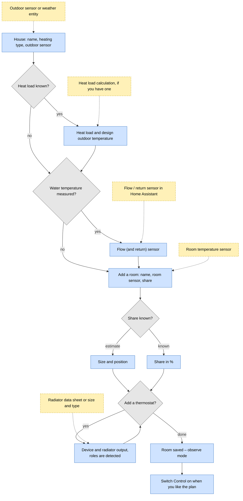

# Getting started

**English** | [Deutsch](../de/getting-started.md)

> Thermogeist is in an early stage (alpha). You can describe your house and its
> [rooms](rooms.md), assign [thermostats](thermostats.md) and let Thermogeist control them room
> by room.

## Install

**Manually from the zip**

1. Download `thermogeist.zip` from the latest release.
2. Unpack it into `config/custom_components/thermogeist/` on your Home Assistant.
3. Restart Home Assistant.

Installation through HACS will be described once Thermogeist is published.

## Describe your house

Go to **Settings → Devices & services → Add integration** and search for **Thermogeist**.

The whole setup at a glance. **Blue** boxes are dialog steps, **grey** diamonds are your
answers, **yellow** boxes are what you should have ready beforehand:

### Step 1: the three essentials

| Field | What to enter |
|---|---|
| Name | How the house should appear, e.g. "Home" or "Granny flat". |
| Heating type | Heat pump, boiler (gas, oil, pellets, district heating) or direct electric heating. This decides how calmly Thermogeist regulates. |
| Outdoor temperature | An outdoor thermometer, your heat pump's outdoor sensor, or your **weather entity** (e.g. *Forecast Home* from Met.no, or OpenWeatherMap) – almost every Home Assistant has one. A weather entity is fine to start; a real sensor is more precise (see below). |

### Step 2: a few questions

Your answers decide what Thermogeist asks next – you only see the fields you need to fill in.

| Question | What follows |
|---|---|
| Do you know the heat load? | **Yes**, if you have a heat load calculation (heating installer or energy consultant): a step asks for the heat load, the design outdoor temperature and, if known, the share outside Thermogeist. **No**: nothing more. |
| Is the water temperature measured? | **No**, **flow only** or **flow and return**: a step asks for the one or two sensors – choose them carefully, see [Choosing the flow temperature sensor](thermostats.md#choosing-the-flow-temperature-sensor). |
| Heated living area | Total heated floor area, without balconies and terraces. Thermogeist uses it to estimate each room's share of the heat load – a 20 m² room in a 160 m² house starts at about 12.5 %. Recommended. |

The values in the follow-up steps:

| Field | What to enter |
|---|---|
| Heat load | The heat your house needs on the coldest design day, in kW, from the heat load calculation. |
| Design outdoor temperature | The outdoor temperature the heat load was calculated for. |
| Share outside Thermogeist | Part of the heat load in rooms Thermogeist will not control, e.g. a bathroom with floor heating. Only if you know it; otherwise it follows from the living area. |
| Flow / return temperature sensor | The water going to the radiators and coming back; with both, Thermogeist uses the measured spread instead of assuming 5 K. |

In the house settings the answers are pre-selected; answering *No* later removes the values that
belong to it.

> **Tip: a good outdoor sensor.** Direct sun makes a thermometer read far too warm, and
> Thermogeist would then heat too little. Mount it in the shade (north side, under a roof
> overhang). If that is not possible, use two or more sensors on different sides of the house
> and combine them with Home Assistant's helper *Combine the state of several sensors*, type
> **minimum** – one of them is always in the shade. A weather entity has no sun problem but
> gives regional model values that are often 1–3 K off and update about once an hour.

> **Tip: finding the design outdoor temperature.** It depends on where you live. Search the
> web for "design outdoor temperature" together with your postcode – in Germany for
> "Normaußentemperatur" and your postcode. If you have a heat load calculation, the value is
> written in it.

You can add more than one house, for example a granny flat with its own heating.

## What you see afterwards

Thermogeist creates a device for your house:

- **Central mode** – *Auto*, *Stop* or *Frost protection* for the whole house. The setting
  survives restarts.
- **Control settings** – four values you can change right on the device page. They start
  with the defaults of your heating type; the attribute `source` shows `profile` or `user`.
  **Reset control settings to profile** brings the defaults back. If you change the heating
  type later, your own values stay and the untouched ones follow the new profile.
- **Diagnostic values** – heating type, heat load, design temperature, share outside
  Thermogeist and heat load not assigned to a room.

Defaults per heating type:

| Default | Heat pump | Boiler | Direct electric |
|---|---|---|---|
| Minimum valve opening | 40 % | 0 % | 0 % |
| Dead band above the setpoint | 0.5 K | 0.2 K | 0.2 K |
| Max. valve change per 30 min | 10 % | 30 % | 100 % |
| Max. setback | 2 K | 4 K | 4 K |
| Window: close after | 30 s | 30 s | 30 s |
| Window: resume heating after | 10 s | 10 s | 10 s |

Why so different? A heat pump works best when water keeps flowing, so Thermogeist keeps
valves open and moves them slowly. A boiler can react faster and cope with valves that close.

## Changing your settings

Open the Thermogeist entry and choose **Configure**. You can change everything except the name;
Thermogeist reloads afterwards.

Next: [add your rooms](rooms.md).
